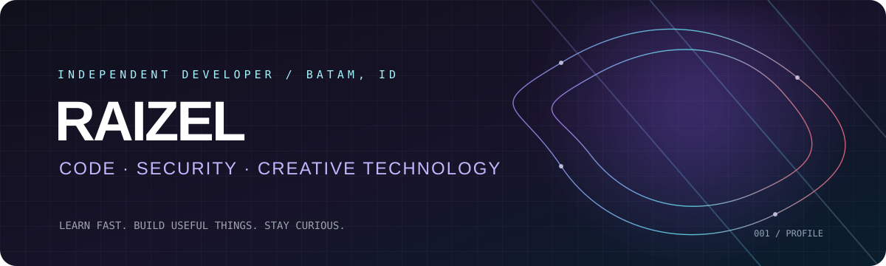

  

<table align="center" border="0">
  <tr>
    <td align="center" valign="middle" width="190">
      
       PERSONAL AVATAR
    </td>
    <td align="center" valign="middle">
      
    </td>
  </tr>
</table>

### RaizeL
**Information Technology Student · Cybersecurity Enthusiast · Developer**

## My GitHub Dashboard

## CONNECT WITH ME

 

𝗉𝗈𝗐𝖾𝗋𝖾𝖽 𝖻𝗒 <a href="https://github.com/collectioneur/readme-aura">𝗋𝖾𝖺𝖽𝗆𝖾-𝖺𝗎𝗋𝖺</a>

***

I'm **Ruchel Afwa Mabrur**, an Information Technology student at **Universitas Internasional Batam (UIB)**, based in Batam, Indonesia. I build digital systems and explore the intersection of web development, cybersecurity, and artificial intelligence.

## About Me

I'm an Information Technology student at **Universitas Internasional Batam (UIB)**, based in Batam, Indonesia. I enjoy building practical software, exploring cybersecurity, and experimenting with AI-assisted workflows.

* Information Technology student at Universitas Internasional Batam (2026–Present).
* Graduate of Teknik Komputer dan Jaringan, SMKN 4 Tanjungpinang (2026).
* 2nd Place, LKS Cyber Security 2026 — Provincial Level.
* Interested in building useful software, understanding system security, and experimenting with AI.

## Skills & Interests

  

### Development & Programming

`Python` · `Rust` · `C` · `JavaScript` · `TypeScript` · `HTML` · `CSS` · `React` · `Next.js`

### Cybersecurity & Infrastructure

* Cybersecurity and security experimentation.
* Networking, network cabling, MikroTik, and server fundamentals.
* System administration.
* Exploring web exploitation, cryptography, digital forensics, reverse engineering, OSINT, and steganography.

### AI & Creative Technology

* AI tools for research, productivity, and development workflows.
* AI-assisted image and video creation.
* AI agents and personal assistant experimentation.
* TikTok streaming and content creation.

### Other Interests

* XAUUSD trading using the BRG method, with a 1:2 risk-to-reward target.
* Gaming, chess, and exploring horror games.

## Selected Projects

| Project | Description | Technologies |
|---|---|---|
| **Raizel AI** | Experimental AI-powered software development assistant focused on project context, code exploration, and controlled file operations. | Next.js, React, TypeScript, OpenAI SDK |
| **BAP Online** | Administrative workflow system with registration numbering, status tracking, and notifications. | JavaScript, HTML, CSS, Google Apps Script, Sheets, Fonnte |
| **SIMANTAP** | Internal digital system developed for administrative workflows at Kantor Imigrasi Kelas I TPI Tanjungpinang. | JavaScript, HTML, CSS, Google Apps Script |
| **Apex Breacher** | Cybersecurity experiment applying security techniques and scripting. | Cybersecurity, Scripting |
| **Nebula Studio** | Web and creative development exploration. | JavaScript, HTML, CSS |
| **Raizel Dodge** | Browser game experiment exploring canvas rendering and game logic. | JavaScript, HTML Canvas |
| **Snake.py** | Snake game implementation exploring game loops and modular logic. | Python |
| **Raizel Calculator** | Calculator project exploring expression parsing and calculation logic. | Python, JavaScript |

**Project repositories:** [Raizel AI](https://github.com/ruchels/raizel-ai) · [BAP Online](https://github.com/ruchels/bap-online-inteldakimtpi)

## Education & Achievement

* **Universitas Internasional Batam** — Teknologi Informasi, 2026–Present.
* **SMKN 4 Tanjungpinang** — Teknik Komputer dan Jaringan, graduated 2026.
* **LKS Cyber Security 2026** — 2nd Place, Provincial Level.

## Connect With Me

* [GitHub](https://github.com/ruchels)
* [LinkedIn](https://www.linkedin.com/in/ruchel-afwa-mabrur-05a082400)
* [Instagram](https://www.instagram.com/3004.ramm)
* [TikTok](https://www.tiktok.com/@raizel.id)
* [Email](mailto:ruchelafwa@gmail.com)

***

  
   
  Designed with intention · Built in public · Always learning

