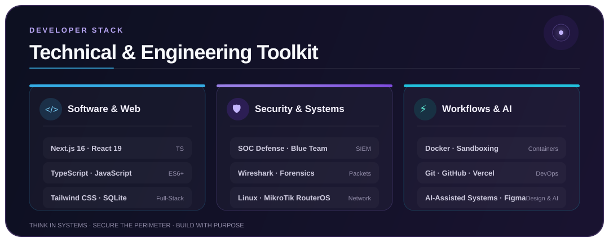
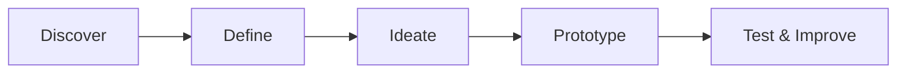

  

# Hi, I'm Ruchel Afwa Mabrur

### UI/UX Designer · Front-End Developer · Information Technology Student

<strong>Batam, Indonesia</strong> · Crafting useful, intuitive, and visually polished digital experiences.

  

I am an Information Technology student at **Universitas Internasional Batam** who blends **user-centered design**, front-end development, and practical problem solving. My work starts with understanding people and ends with polished interfaces that are accessible, consistent, and easy to use.

  

  

## Featured Projects

### [Seaside](https://seaside-ruchel.vercel.app)

A polished personal web experience built to present projects, identity, and professional work in a clear and memorable format.

**Role:** UI/UX, Front-End Development\
**Stack:** TypeScript · React · Next.js · CSS

***

### [BAP Online](https://bap-online-inteldakimtpi.vercel.app)

A digital administrative workflow for registration numbering, status tracking, notifications, and public forms.

**Role:** Interface Design, Front-End, Workflow\
**Stack:** JavaScript · HTML · CSS · Google Apps Script

***

### [Raizel AI](https://raizel-ai.vercel.app)

An experimental AI software assistant designed around project context, code exploration, and controlled file operations.

**Role:** Product Design, Interface Design, Front-End\
**Stack:** Next.js · React · TypeScript

## Design Approach

I follow an iterative process: understand the problem, map user needs, explore visual directions, prototype quickly, and improve through feedback.

## GitHub Dashboard

## Experience & Education

* **Information Technology Student** — Universitas Internasional Batam, 2026–Present
* **Teknik Komputer dan Jaringan** — SMKN 4 Tanjungpinang, Graduated 2026
* **LKS Cyber Security 2026** — 2nd Place, Provincial Level
* **Digital Administrative Systems** — Internal workflow and web system development

## Beyond the Interface

I also explore cybersecurity, networking, system administration, AI-assisted workflows, and ethical security experimentation. These areas help me design interfaces with a stronger understanding of real systems, users, and constraints.

## Let's Connect

Designed with intention · Built with purpose · Always learning

