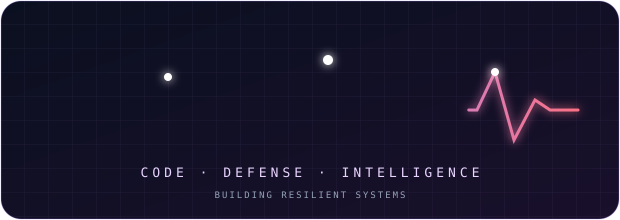
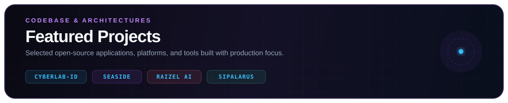
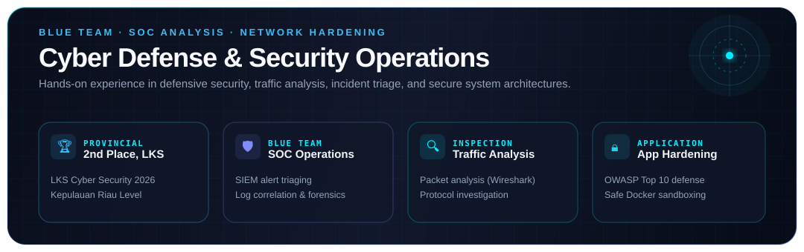
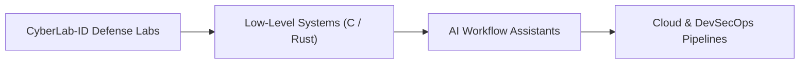
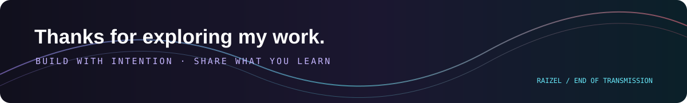

  

# Hi, I'm Ruchel Afwa Mabrur

### Information Technology Student · Software Developer · Cybersecurity Enthusiast · AI Explorer

<strong>Batam, Indonesia</strong> · Building digital experiences, exploring intelligent systems, and securing modern architectures.

 

  

## About Me

I am an Information Technology student at **Universitas Internasional Batam** with a vocational foundation in Computer Systems & Networking (**SMKN 4 Tanjungpinang - TKJ**). I bridge **full-stack software engineering**, **defensive cybersecurity**, and **intelligent systems** to build digital products that are resilient, performant, and secure by design.

* 💻 **Software Engineering**: Architecting full-stack web platforms with Next.js, React, TypeScript, and SQLite.
* 🛡️ **Defensive Cybersecurity**: Practicing Blue Team operations, SOC log correlation, network forensics, and practical range defense.
* 🤖 **AI Exploration**: Building context-aware developer tools, prompt architectures, and controlled procedural workflows.
* ⚡ **Systems & Networks**: Configuring MikroTik routing, hardening Linux environments, and deploying sandboxed Docker containers.
* 🏆 **Competitive Security**: **2nd Place Winner** at the Provincial LKS Cyber Security 2026 competition.

***

  

## Technical Domains

| Domain | Focus Areas | Key Technologies & Practices |
|---|---|---|
| **Software Engineering** | Full-Stack Web, Modern Front-End, Scalable API Architecture | Next.js 16, React 19, TypeScript, JavaScript, REST APIs, SQLite ACID |
| **Cyber Defense & SOC** | Defensive Security, Incident Triage, Traffic Forensics, OWASP Defense | Blue Team Operations, Wireshark, SIEM Event Analysis, Range Labs, LKS 2026 |
| **Networks & Systems** | Linux Hardening, Network Routing, Container Sandboxing | Ubuntu/Debian, MikroTik RouterOS, TCP/IP, VLAN, Docker, Bash Scripting |
| **AI & Product Design** | Intelligent Tooling, Prompt Engineering, Design Systems, UX | AI-Assisted Workflows, Web Audio API, Tailwind CSS, Responsive a11y |

***

  

## Tech Stack

### Languages & Core

### Frontend & UI Architecture

### Defensive Cybersecurity & Systems

### Workflows & Developer Tools

***

  

## Featured Projects

### 🛡️ [CyberLab-ID](https://github.com/ruchels/cyberlab-id) — Cybersecurity Education & SOC Platform

> **Flagship Project** · Bilingual Cybersecurity Learning Platform, Cyber Range & SOC Defense Simulator

An extensive, production-grade cybersecurity education ecosystem built from the ground up across 10 architectural phases:

* **Interactive Academy & CTF Arena**: Hands-on challenges covering Web Security, Network Forensics, Reverse Engineering, and Cryptography.

* **AI Learning Assistant & Range Container Sandbox**: Dynamic, sandboxed practice environment with real-time defense simulations.

* **Defensive Blue Team & SOC Operations**: Incident triage dashboard, SIEM log correlation, MITRE ATT\&CK mapping, and threat feeds.

* **Audio & Visual Experience**: Procedural synthesizer sound design with Web Audio API and responsive collapsible sidebar.

* **Rigorous Engineering**: 330+ automated unit and integration tests with transactional SQLite ACID reliability.

* **Role:** Sole Architect & Full-Stack Developer

* **Stack:** Next.js 16 (App Router) · React 19 · TypeScript · Tailwind CSS v4 · SQLite (`better-sqlite3`) · Web Audio API · Docker

***

### 🌊 [Seaside](https://seaside-ruchel.vercel.app) — Personal Digital Showcase

> Personal developer web experience engineered to present identity, projects, and creative code.

A refined web portfolio featuring fluid responsive layouts, modern design tokens, accessible components, and creative motion.

* **Role:** UI/UX Architecture, Front-End Development
* **Stack:** Next.js · React · TypeScript · CSS Motion Design

***

### 🤖 [Raizel AI](https://raizel-ai.vercel.app) — Experimental Intelligence Assistant

> Context-aware AI software assistant designed around developer workspaces, code exploration, and controlled operations.

Explores dynamic prompting, project context parsing, structured LLM streaming, and secure local file operations.

* **Role:** Product Design, Systems Architecture, Front-End
* **Stack:** Next.js · React · TypeScript · AI SDK APIs

***

### 📋 [Sipalarus (BAP Online)](https://sipalarus.com) — Administrative Workflow System

> Digital administrative workflow engine for automated registration numbering, status tracking, notifications, and public records.

Developed to streamline administrative processes, reducing manual verification overhead through digital validation, cloud scripting, and responsive interfaces.

* **Role:** Interface Design, Front-End Development, Workflow Automation
* **Stack:** JavaScript · HTML5 · CSS3 · Google Apps Script · Cloud Integration

***

  

## Cybersecurity & Defense

Practical security skills backed by competition achievements and hands-on laboratory experimentation:

* 🏆 **LKS Cyber Security 2026 (Provincial Level)** — **2nd Place Winner** (Provinsi Kepulauan Riau).
* 🛡️ **Blue Team & SOC Operations**: Triaging security alerts, correlating SIEM logs, analyzing malicious indicators, and mapping tactics to MITRE ATT\&CK.
* 🔍 **Network Forensics & Packet Analysis**: Deep packet inspection using Wireshark, TCP stream reassembly, protocol anomaly detection, and traffic auditing.
* 🔒 **Web Application Defense**: Remediating OWASP Top 10 vulnerabilities (SQLi, XSS, CSRF, IDOR, SSRF) and enforcing defense-in-depth principles.
* ⚙️ **Infrastructure Hardening**: Linux server hardening, firewall configuration (UFW / iptables), MikroTik security policies, and isolated Docker network perimeters.

***

## Current Focus & Roadmap

* 🛡️ **CyberLab-ID Ecosystem**: Expanding defensive SOC simulations, real-world scenario modules, and sandboxed attack-defense exercises.
* 🦀 **Low-Level Systems**: Deepening understanding of systems programming, memory safety, and networking sockets with C and Rust.
* 🤖 **Intelligent Tooling**: Building safe, autonomous agent workflows for code review and security audits.
* 🌐 **DevSecOps**: Implementing automated security scans (SAST/DAST) in containerized deployment pipelines.

***

## GitHub Dashboard

 

 

***

## Education & Verified Milestones

* 🎓 **Universitas Internasional Batam** — Undergraduate in Information Technology (*2026 – Present*)
* 🏫 **SMKN 4 Tanjungpinang** — Vocational Diploma in Teknik Komputer dan Jaringan / TKJ (*Graduated 2026*)
* 🏆 **2nd Place Winner** — LKS Cyber Security 2026 (Tingkat Provinsi Kepulauan Riau)
* 💼 **Digital Administrative Systems** — Production workflow deployment and automation (*Sipalarus / BAP Online*)

***

## Connect With Me

 

Designed with intention · Built with purpose · Securing the future

