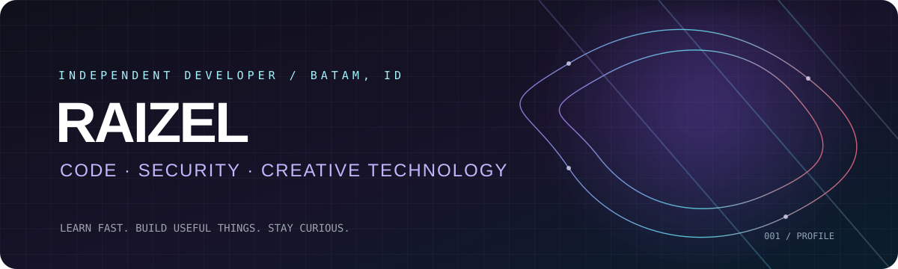
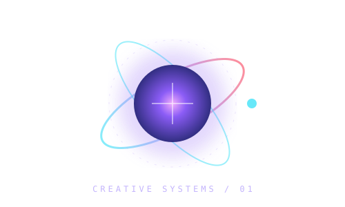
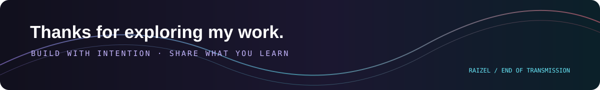

<div align="center">
  
</div>

<div align="center">
  
  <br/>
  
</div>

<div align="center">
### RaizeL
**Information Technology Student · Cybersecurity Enthusiast · Developer**

[](https://github.com/ruchels)
[](https://www.linkedin.com/in/ruchel-afwa-mabrur-05a082400/)
[](https://www.instagram.com/3004.ramm)
[](https://www.tiktok.com/@raizel.id)
</div>


## My GitHub Dashboard


```aura width=860 height=140
(function() {
 var stats = [
   { label: 'Repos', value: String((github && github.stats && github.stats.totalRepos) || 0), color: '#a78bfa' },
   { label: 'Stars', value: String((github && github.stats && github.stats.totalStars) || 0), color: '#60a5fa' },
   { label: 'Commits', value: String((github && github.stats && github.stats.totalCommits) || 0), color: '#f59e0b' },
 ];

 return (
   <div style={{
     width: '100%', height: '100%',
     background: '#08080c',
     display: 'flex', alignItems: 'center', justifyContent: 'center',
     fontFamily: 'Inter', borderRadius: 16,
     border: '1px solid rgba(110,80,220,0.18)',
     position: 'relative', overflow: 'hidden',
   }}>

     <style>
       {`
         @keyframes float-slow {
           0%, 100% { transform: translateX(0px); opacity: 0.8; }
           50% { transform: translateX(350px); opacity: 1.2; }
         }
         @keyframes float-medium {
           0%, 100% { transform: translateX(0px); opacity: 0.7; }
           50% { transform: translateX(-250px); opacity: 1.1; }
         }
         @keyframes float-fast {
           0%, 100% { transform: translateX(0px); opacity: 0.9; }
           50% { transform: translateX(200px); opacity: 0.6; }
         }
         @keyframes float-diagonal {
           0%, 100% { transform: translate(0px, 0px); opacity: 0.75; }
           50% { transform: translate(120px, 30px); opacity: 1.0; }
         }
         @keyframes float-wave {
           0%, 100% { transform: translateX(0px); opacity: 0.65; }
           33% { transform: translateX(-160px); opacity: 0.9; }
           66% { transform: translateX(80px); opacity: 1.0; }
         }
         @keyframes float-pulse {
           0%, 100% { transform: scale(1); opacity: 0.8; }
           50% { transform: scale(1.3); opacity: 0.4; }
         }
         #glow-1 { animation: float-slow 8s ease-in-out infinite; }
         #glow-2 { animation: float-medium 12s ease-in-out infinite; }
         #glow-3 { animation: float-fast 9s ease-in-out infinite; }
         #glow-4 { animation: float-diagonal 10s ease-in-out infinite; }
         #glow-5 { animation: float-wave 14s ease-in-out infinite; }
       `}
     </style>

     <svg width="860" height="140" style={{ position: 'absolute', top: 0, left: 0 }}>
       <defs>
         <radialGradient id="g1" cx="50%" cy="50%" r="50%">
           <stop offset="0%" stopColor="rgba(110,20,210,0.65)" />
           <stop offset="45%" stopColor="rgba(80,15,170,0.28)" />
           <stop offset="70%" stopColor="rgba(80,15,170,0)" />
         </radialGradient>
         <radialGradient id="g2" cx="50%" cy="50%" r="50%">
           <stop offset="0%" stopColor="rgba(40,70,255,0.55)" />
           <stop offset="45%" stopColor="rgba(20,50,200,0.22)" />
           <stop offset="70%" stopColor="rgba(20,50,200,0)" />
         </radialGradient>
         <radialGradient id="g3" cx="50%" cy="50%" r="50%">
           <stop offset="0%" stopColor="rgba(0,140,255,0.42)" />
           <stop offset="70%" stopColor="rgba(0,140,255,0)" />
         </radialGradient>
         <radialGradient id="g4" cx="50%" cy="50%" r="50%">
           <stop offset="0%" stopColor="rgba(0,195,235,0.30)" />
           <stop offset="70%" stopColor="rgba(0,195,235,0)" />
         </radialGradient>
         <radialGradient id="g5" cx="50%" cy="50%" r="50%">
           <stop offset="0%" stopColor="rgba(100,30,210,0.40)" />
           <stop offset="70%" stopColor="rgba(100,30,210,0)" />
         </radialGradient>
       </defs>
       <ellipse id="glow-1" cx="710" cy="150" rx="210" ry="150" fill="url(#g1)" />
       <ellipse id="glow-2" cx="550" cy="140" rx="190" ry="140" fill="url(#g2)" />
       <ellipse id="glow-3" cx="400" cy="130" rx="170" ry="130" fill="url(#g3)" />
       <ellipse id="glow-4" cx="250" cy="140" rx="150" ry="120" fill="url(#g4)" />
       <ellipse id="glow-5" cx="100" cy="150" rx="130" ry="110" fill="url(#g5)" />
     </svg>

     {stats.map(function(s, i) {
       return (
         <div key={s.label} style={{
           flexGrow: 1, display: 'flex', flexDirection: 'column',
           alignItems: 'center', justifyContent: 'center',
           padding: '16px 8px',
           borderRight: i < stats.length - 1 ? '1px solid rgba(255,255,255,0.06)' : 'none',
           gap: 5,
         }}>
           <div style={{ display:'flex', fontSize:30, fontWeight:800, color:s.color, lineHeight:1 }}>
             {s.value}
           </div>
           <div style={{ display:'flex', fontSize:11, color:'rgba(200,195,225,0.45)', fontWeight:600, letterSpacing:'1.5px' }}>
             {s.label.toUpperCase()}
           </div>
         </div>
       );
     })}
   </div>
 );
})()
```

```aura width=860 height=168
(function() {
 var topLangs = (github && github.languages && github.languages.length > 0 ? github.languages.slice(0, 6).map(function(l) { return l.name; }) : ['TypeScript', 'React', 'Next.js', 'C++', 'Go', 'Rust']);
 var categories = [
   { title: 'Languages', color: '#a78bfa', items: topLangs },
   { title: 'Frameworks', color: '#60a5fa', items: ['React Native', 'React', 'Next.js'] },
 ];

 return (
   <div style={{
     width: '100%', height: '100%',
     background: '#08080c',
     display: 'flex', flexDirection: 'column',
     fontFamily: 'Inter', padding: '18px 32px', gap: 14,
     borderRadius: 16, border: '1px solid rgba(110,80,220,0.18)',
     position: 'relative', overflow: 'hidden',
   }}>

     <style>
       {`
         @keyframes float-slow {
           0%, 100% { transform: translateX(0px); opacity: 0.8; }
           50% { transform: translateX(350px); opacity: 1.2; }
         }
         @keyframes float-medium {
           0%, 100% { transform: translateX(0px); opacity: 0.7; }
           50% { transform: translateX(-250px); opacity: 1.1; }
         }
         @keyframes float-fast {
           0%, 100% { transform: translateX(0px); opacity: 0.9; }
           50% { transform: translateX(200px); opacity: 0.6; }
         }
         @keyframes float-diagonal {
           0%, 100% { transform: translate(0px, 0px); opacity: 0.75; }
           50% { transform: translate(120px, 30px); opacity: 1.0; }
         }
         @keyframes float-wave {
           0%, 100% { transform: translateX(0px); opacity: 0.65; }
           33% { transform: translateX(-160px); opacity: 0.9; }
           66% { transform: translateX(80px); opacity: 1.0; }
         }
         @keyframes float-pulse {
           0%, 100% { transform: scale(1); opacity: 0.8; }
           50% { transform: scale(1.3); opacity: 0.4; }
         }
         #glow-1 { animation: float-slow 9s ease-in-out infinite; }
         #glow-2 { animation: float-medium 12s ease-in-out infinite; }
         #glow-3 { animation: float-fast 8s ease-in-out infinite; }
         #glow-4 { animation: float-diagonal 11s ease-in-out infinite reverse; }
         #glow-5 { animation: float-wave 14s ease-in-out infinite reverse; }
         #glow-6 { animation: float-pulse 6s ease-in-out infinite; }
       `}
     </style>

     <svg width="860" height="168" style={{ position: 'absolute', top: 0, left: 0 }}>
       <defs>
         <radialGradient id="g1" cx="50%" cy="50%" r="50%">
           <stop offset="0%" stopColor="rgba(115,20,215,0.68)" />
           <stop offset="42%" stopColor="rgba(85,15,175,0.30)" />
           <stop offset="70%" stopColor="rgba(85,15,175,0)" />
         </radialGradient>
         <radialGradient id="g2" cx="50%" cy="50%" r="50%">
           <stop offset="0%" stopColor="rgba(55,55,255,0.55)" />
           <stop offset="45%" stopColor="rgba(35,45,210,0.22)" />
           <stop offset="70%" stopColor="rgba(35,45,210,0)" />
         </radialGradient>
         <radialGradient id="g3" cx="50%" cy="50%" r="50%">
           <stop offset="0%" stopColor="rgba(0,130,255,0.42)" />
           <stop offset="50%" stopColor="rgba(0,100,220,0.16)" />
           <stop offset="70%" stopColor="rgba(0,100,220,0)" />
         </radialGradient>
         <radialGradient id="g4" cx="50%" cy="50%" r="50%">
           <stop offset="0%" stopColor="rgba(0,185,240,0.32)" />
           <stop offset="70%" stopColor="rgba(0,185,240,0)" />
         </radialGradient>
         <radialGradient id="g5" cx="50%" cy="50%" r="50%">
           <stop offset="0%" stopColor="rgba(100,25,205,0.42)" />
           <stop offset="70%" stopColor="rgba(100,25,205,0)" />
         </radialGradient>
         <radialGradient id="g6" cx="50%" cy="50%" r="50%">
           <stop offset="0%" stopColor="rgba(60,80,255,0.35)" />
           <stop offset="70%" stopColor="rgba(60,80,255,0)" />
         </radialGradient>
       </defs>
       <ellipse id="glow-1" cx="170" cy="168" rx="260" ry="170" fill="url(#g1)" />
       <ellipse id="glow-2" cx="320" cy="178" rx="220" ry="140" fill="url(#g2)" />
       <ellipse id="glow-3" cx="460" cy="178" rx="190" ry="130" fill="url(#g3)" />
       <ellipse id="glow-4" cx="590" cy="188" rx="160" ry="110" fill="url(#g4)" />
       <ellipse id="glow-5" cx="750" cy="188" rx="140" ry="100" fill="url(#g5)" />
       <ellipse id="glow-6" cx="420" cy="138" rx="100" ry="80" fill="url(#g6)" />
     </svg>

     <div style={{ display:'flex', fontSize:10, fontWeight:700, color:'rgba(155,140,210,0.5)', letterSpacing:'3px' }}>
       TECH STACK
     </div>
     <div style={{ display:'flex', flexDirection:'column', gap:14 }}>
       {categories.map(function(cat) {
         return (
           <div key={cat.title} style={{ display:'flex', alignItems:'center', gap:16 }}>
             <div style={{ display:'flex', fontSize:10, fontWeight:700, color:cat.color, letterSpacing:'1px', width:80 }}>
               {cat.title.toUpperCase()}
             </div>
             <div style={{ display:'flex', flexWrap:'wrap', gap:7 }}>
               {cat.items.map(function(item) {
                 return (
                   <div key={item} style={{
                     display:'flex', padding:'4px 13px', borderRadius:6,
                     background:cat.color + '15', border:'1px solid ' + cat.color + '35',
                     color:'rgba(225,220,255,0.85)', fontSize:12, fontWeight:600,
                   }}>{item}</div>
                 );
               })}
             </div>
           </div>
         );
       })}
     </div>
   </div>
 );
})()
```

## CONNECT WITH ME

```aura width=132 height=44 link="https://www.linkedin.com/in/ruchel-afwa-mabrur-05a082400/" inline align=center
<SocialMediaButton
  icon="https://cdn.simpleicons.org/linkedin/0A66C2"
  text="LinkedIn"
  backgroundColor="#071B2D"
  textColor="#FFFFFF"
  width={132}
  height={44}
  iconSize={20}
/>
```

```aura width=138 height=44 link="https://www.instagram.com/3004.ramm" inline align=center
<SocialMediaButton
  icon="https://cdn.simpleicons.org/instagram/FF0069"
  text="Instagram"
  backgroundColor="#35091D"
  textColor="#FFFFFF"
  width={138}
  height={44}
  iconSize={20}
/>
```

```aura width=115 height=44 link="https://www.tiktok.com/@raizel.id" inline align=center
<SocialMediaButton
  icon="https://cdn.simpleicons.org/tiktok/FFFFFF"
  text="TikTok"
  backgroundColor="#141414"
  textColor="#FFFFFF"
  width={115}
  height={44}
  iconSize={20}
/>
```

```aura width=112 height=44 link="mailto:ruchelafwa@gmail.com" inline align=center
<SocialMediaButton
  icon="https://cdn.simpleicons.org/gmail/EA4335"
  text="Email"
  backgroundColor="#350D0D"
  textColor="#FFFFFF"
  width={112}
  height={44}
  iconSize={20}
/>
```


<br>
<p align="center"><sub>𝗉𝗈𝗐𝖾𝗋𝖾𝖽 𝖻𝗒 <a href="https://github.com/collectioneur/readme-aura">𝗋𝖾𝖺𝖽𝗆𝖾-𝖺𝗎𝗋𝖺</a></sub></p>

---

I'm **Ruchel Afwa Mabrur**, an Information Technology student at **Universitas Internasional Batam (UIB)**, based in Batam, Indonesia. I build digital systems and explore the intersection of web development, cybersecurity, and artificial intelligence.

## About Me

I'm an Information Technology student at **Universitas Internasional Batam (UIB)**, based in Batam, Indonesia. I enjoy building practical software, exploring cybersecurity, and experimenting with AI-assisted workflows.


- Information Technology student at Universitas Internasional Batam (2026–Present).
- Graduate of Teknik Komputer dan Jaringan, SMKN 4 Tanjungpinang (2026).
- 2nd Place, LKS Cyber Security 2026 — Provincial Level.
- Interested in building useful software, understanding system security, and experimenting with AI.

## Skills & Interests

<div align="center">
  
</div>


### Development & Programming
`Python` · `Rust` · `C` · `JavaScript` · `TypeScript` · `HTML` · `CSS` · `React` · `Next.js`

### Cybersecurity & Infrastructure
- Cybersecurity and security experimentation.
- Networking, network cabling, MikroTik, and server fundamentals.
- System administration.
- Exploring web exploitation, cryptography, digital forensics, reverse engineering, OSINT, and steganography.

### AI & Creative Technology
- AI tools for research, productivity, and development workflows.
- AI-assisted image and video creation.
- AI agents and personal assistant experimentation.
- TikTok streaming and content creation.

### Other Interests
- XAUUSD trading using the BRG method, with a 1:2 risk-to-reward target.
- Gaming, chess, and exploring horror games.

## Selected Projects


| Project | Description | Technologies |
|---|---|---|
| **Raizel AI** | Experimental AI-powered software development assistant focused on project context, code exploration, and controlled file operations. | Next.js, React, TypeScript, OpenAI SDK |
| **BAP Online** | Administrative workflow system with registration numbering, status tracking, and notifications. | JavaScript, HTML, CSS, Google Apps Script, Sheets, Fonnte |
| **SIMANTAP** | Internal digital system developed for administrative workflows at Kantor Imigrasi Kelas I TPI Tanjungpinang. | JavaScript, HTML, CSS, Google Apps Script |
| **Apex Breacher** | Cybersecurity experiment applying security techniques and scripting. | Cybersecurity, Scripting |
| **Nebula Studio** | Web and creative development exploration. | JavaScript, HTML, CSS |
| **Raizel Dodge** | Browser game experiment exploring canvas rendering and game logic. | JavaScript, HTML Canvas |
| **Snake.py** | Snake game implementation exploring game loops and modular logic. | Python |
| **Raizel Calculator** | Calculator project exploring expression parsing and calculation logic. | Python, JavaScript |

**Project repositories:** [Raizel AI](https://github.com/ruchels/raizel-ai) · [BAP Online](https://github.com/ruchels/bap-online-inteldakimtpi)

## Education & Achievement

- **Universitas Internasional Batam** — Teknologi Informasi, 2026–Present.
- **SMKN 4 Tanjungpinang** — Teknik Komputer dan Jaringan, graduated 2026.
- **LKS Cyber Security 2026** — 2nd Place, Provincial Level.

## Connect With Me

- [GitHub](https://github.com/ruchels)
- [LinkedIn](https://www.linkedin.com/in/ruchel-afwa-mabrur-05a082400)
- [Instagram](https://www.instagram.com/3004.ramm)
- [TikTok](https://www.tiktok.com/@raizel.id)
- [Email](mailto:ruchelafwa@gmail.com)

---


<div align="center">
  
  <br/>
  <sub>Designed with intention · Built in public · Always learning</sub>
</div>
